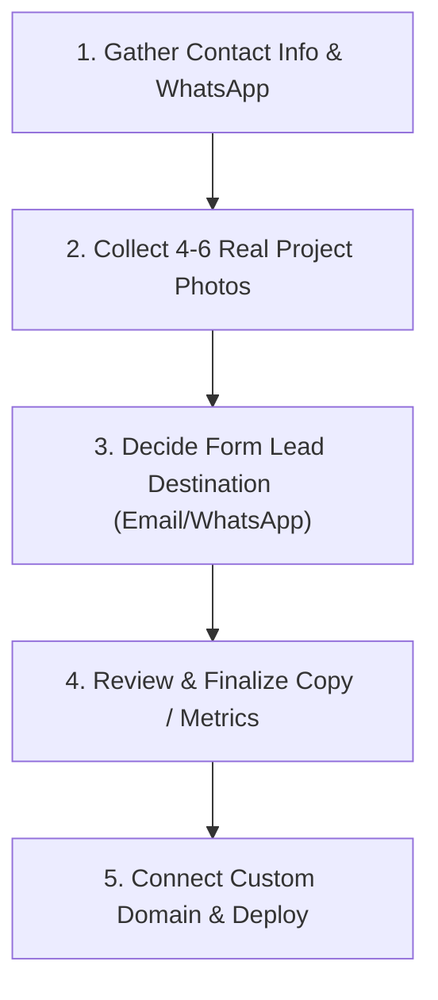

# Peedika Interior Consultants — Website Asset & Information Intake Checklist

This document details every piece of business information, branding asset, project media, and technical configuration required to transition the **Peedika Interior Consultants** website from placeholder content to a fully launched, production-ready commercial web presence.

---

## 1. Contact & Communication Information

These details will appear across the Top Bar, Navbar, Contact Section, Footer, and Contact Forms.

| Item | Description | Placeholder in Code | Your Official Detail |
|---|---|---|---|
| **Primary Inquiries Email** | General public email for client inquiries and quote requests | `hello@peedika.com` | `[ Your Email ]` |
| **Direct Phone Number** | Contact number for phone calls (with country code `+91`) | *None* | `[ +91 ... ]` |
| **Official WhatsApp Business** | WhatsApp number for direct client chat integration | *None* | `[ +91 ... ]` |
| **Physical Office Address** | Exact registered / studio office address in Kochi, Kerala | `Headquarters: Kochi, Kerala` | `[ Full Address with Pincode ]` |
| **Operating Regions** | Cities/states covered for turnkey execution | `Pan-India (Kochi, Bengaluru, Mumbai, etc.)` | `[ Verified List of Regions ]` |
| **Google Maps Embed Link** | Location pin for Kochi design studio | *None* | `[ Google Maps URL / Embed ]` |
| **Working Hours** | Studio opening hours for consultations | *None* | `[ e.g. Mon–Sat: 9:30 AM – 6:30 PM ]` |

---

## 2. Social Media & External Profiles

Links to build credibility and showcase ongoing retail fit-outs.

- [ ] **Instagram Profile URL** *(Essential for interior design portfolios & reels)*
- [ ] **LinkedIn Company Page URL** *(Valuable for B2B commercial & retail chain tie-ups)*
- [ ] **Facebook Page URL** *(Optional)*
- [ ] **Pinterest / Behance Profile URL** *(Optional, for visual moodboards)*
- [ ] **YouTube Channel URL** *(Optional, for 3D walkthrough animations or site tours)*

---

## 3. Brand Identity & Visual Assets

High-resolution assets ensure the site looks crisp on Retina and 4K displays.

### A. Logos & Icons
- [ ] **Vector Logo (SVG or transparent PNG)**:
  - Dark version (for sand/light backgrounds)
  - Light/brass version (for dark emerald backgrounds and the shutter)
- [ ] **Favicon**: 32x32px and 512x512px app icon for browser tabs and mobile bookmarks
- [ ] **Shutter Graphic Preferences**: Confirmation on whether the current bold serif typography on the shutter matches the brand's intended signage aesthetic.

### B. Project Photography & Media
Currently, the site uses high-quality placeholder retail photography from Unsplash. Replacing these with authentic project photos will establish genuine trust:

- [ ] **Hero Showcase Photo** (Aspect ratio 4:3 or 16:9, min 1920x1080px): Modern retail interior representing your highest-profile store execution.
- [ ] **Portfolio Project 1 (Flagship / Boutique)**:
  - 1–3 high-resolution photos
  - Project Name (e.g. *Earth & Loom Flagship Store*)
  - Location (e.g. *Indiranagar, Bengaluru*)
  - Retail Category (e.g. *Apparel & Lifestyle*)
  - Area / Sq. Ft. (Optional)
- [ ] **Portfolio Project 2 (Café / Hospitality)**:
  - 1–3 high-resolution photos
  - Project Name (e.g. *Roastery Coffee House*)
  - Location (e.g. *Panampilly Nagar, Kochi*)
  - Category (e.g. *Hospitality & Specialty Café*)
- [ ] **Portfolio Project 3 (Luxury / Jewellery / Retail)**:
  - Photos, location, category
- [ ] **3D Renderings / Walkthroughs** *(Optional)*: Before/after renders or 3D store models.

---

## 4. Business Copy & Positioning Adjustments

Confirm or refine the specific wording to align with your exact business model:

### A. Core Value Proposition
- **Tagline**: Currently *"We build shops that can sell."* (Is this confirmed?)
- **About Narrative**: The connection between traditional Kerala *Peedika* (community marketplace/shop craftsmanship) and modern retail conversion science.
- **Key Statistics**: Current values are `Pan-India Capability`, `ROI Focused Layout`, `End-to-End Turnkey`, `Heritage Rooted`. Do you have specific numerical metrics (e.g. *50+ Stores Executed*, *100,000+ Sq. Ft. Designed*, *8+ Years Experience*)?

### B. Execution Flowchart (7 Steps)
Review if the 7-step process matches your exact workflow:
1. Understanding Client Requirement
2. Recce & Space Planning
3. 2D & 3D Walkthrough
4. GFC (Good For Construction) Drawing Preparation
5. Material & Product Selection
6. Interior Execution (On-Site Management)
7. Facility & Maintenance Support

---

## 5. Lead Capture & Form Destination

When a potential client submits the *"Let's build a shop that can sell"* form:

- [ ] **Lead Recipient Email**: Email address where new inquiries should be delivered instantly.
- [ ] **Form Handling Method**:
  - *Option 1 (Recommended & Free)*: Formspree / Web3Forms / EmailJS (no server required, forwards directly to email).
  - *Option 2*: Direct WhatsApp redirection with pre-filled message containing form data.
  - *Option 3*: Google Sheets / Notion integration via webhook.
- [ ] **Custom Form Fields**: Currently captures `Name`, `Brand / Store Name`, `Target City`, and `Message`. Let us know if you need `Approximate Store Area (Sq. Ft.)` or `Estimated Budget Range`.

---

## 6. Domain, Hosting & Launch Configuration

To take the website live on your custom domain:

- [ ] **Domain Name**: Domain status (e.g., `peedika.com`, `peedikadesign.com`, or `peedika.in`).
- [ ] **Domain Registrar**: Where the domain is bought (GoDaddy, Namecheap, Google Domains / Squarespace, Hostinger).
- [ ] **Deployment Platform**: Preferred hosting platform (Vercel, Netlify, or GitHub Pages — all offer free SSL, global CDN, and automatic deployment from your GitHub repo).
- [ ] **Google Analytics / Meta Pixel ID** *(Optional)*: Tracking measurement IDs for marketing analytics.

---

## 7. Legal & Compliance Footers

To ensure commercial compliance:

- [ ] **Registered Legal Entity Name**: (e.g., *Peedika Interior Consultants LLP* or *Peedika Design Studio Pvt. Ltd.*)
- [ ] **GST Number** *(Optional, if required on formal proposals/invoices)*
- [ ] **Privacy Policy / Terms of Service**: Basic standard policy for lead collection.

---

## Summary Action Plan

> [!TIP]
> You do not need all items at once. Providing **Section 1 (Contact Info)**, **Section 3B (Project Photos)**, and **Section 5 (Lead Email)** is sufficient to make the website 100% functional.

